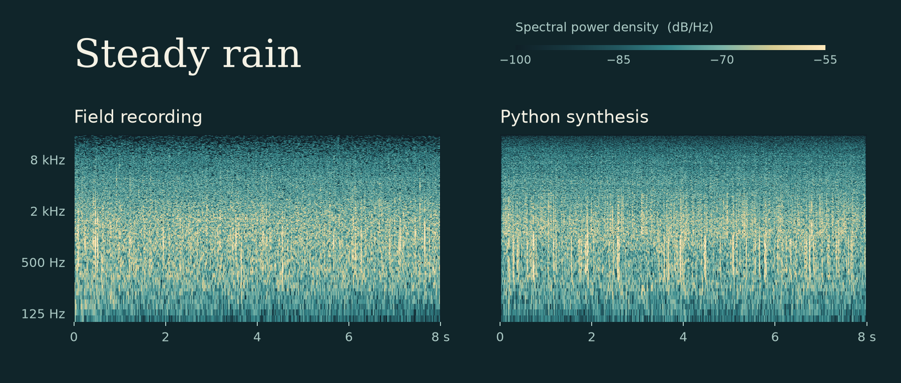

# Code2Audio

An agent turns a short recording into a Python program that synthesizes a similar sound. Each accepted dataset record pairs the program and its parameters with a caption and a reproducible WAV.



**Listen**　[Field recording · 8 s](examples/rain/reference.wav)　/　[Python synthesis · 8 s](examples/rain/generated.wav)  
[Explore the rain program](examples/rain/program.py) · [Run the example](#run-the-example) · [Build a dataset](#build-a-dataset) · [Agent skill](#agent-skill)

The bright band around 1 kHz appears in both clips. The program fits the average spectral shape of the rain, then draws fresh droplet impacts over a diffuse background. Changing the seed moves the individual impacts while preserving the overall texture.

<details>
<summary>Rain example · measurements and verification</summary>

The reference is an eight-second excerpt starting at 01:00. The fitter measures the mid/side spectrum, the concentration of energy in brief impacts in each band, and slow changes in level. Those statistics set the spectral color, event density and stereo field of the synthesis. [Source recording](https://www.bilibili.com/video/BV1aio9B2EBD/) · [Fitter](examples/rain/fit.py) · [Parameters](examples/rain/parameters.json) · [Component model](examples/rain/model.json)

Qwen independently captioned both clips as *“Heavy rain falling steadily with a consistent patter.”* For the illustrated seed, CLAP scored the recording **0.4485** and the synthesis **0.4466** against the same reference descriptions. These audio–text cosine scores measure semantic agreement. [Full verification report](examples/rain/verification.json)

</details>

## How it works

1. **Analyze the reference.** The pipeline measures spectral peaks, band energy, envelope variation and stereo correlation. Qwen captions the excerpt in a separate request. The coding agent uses both sources of evidence to choose the sound components to model.
2. **Write and render a program.** The agent writes a waveform function, editable parameters and component notes. The function computes samples directly with NumPy and SciPy and runs from its parameters and seed alone. The runner renders several seeds and repeats one to check exact PCM reproduction.
3. **Verify and revise.** Qwen describes each render independently. CLAP scores the reference and every render against a fixed set of target descriptions. The agent uses the measurements and score differences to revise its code within a round budget. The pipeline retains the best passing candidate.
4. **Export the data.** Each selected seed becomes a record with code, parameters, generated audio, captions and verification evidence. Excerpts from the same source stay in the same dataset split. [Verification protocol](docs/pipeline.md) · [Dataset format](docs/dataset.md)

## Run the example

From the project root, use Python 3.11 or later on macOS or Linux.

```bash
python -m venv .venv
source .venv/bin/activate
python -m pip install -e .
c2a demo --out runs/rain-demo
```

The demo runs offline, writes `runs/rain-demo/generated.wav` and compares its hash with the bundled render. The [reproducibility record](examples/rain/reproducibility.json) lists the numerical library versions used for the included example.

<details>
<summary>Change the seed, refit the parameters or redraw the figure</summary>

```bash
c2a render --program examples/rain/program.py \
  --parameters examples/rain/parameters.json \
  --output runs/rain-seed-31.wav --duration 8 --sample-rate 44100 --seed 31

python examples/rain/fit.py examples/rain/reference.wav runs/rain-parameters.json

python -m pip install -e '.[figures]'
python examples/rain/plot.py
```

</details>

## Build a dataset

Install the verification dependencies, download the CLAP weights and put your Qwen API key in the local `.env` file.

```bash
python -m pip install -e '.[verify]'
c2a fetch-model --out models/clap
cp .env.example .env
```

Set `QWEN_API_KEY` in `.env`. The default coding agent uses an authenticated local Codex CLI. Qwen receives one audio excerpt per caption request and CLAP runs locally. The included manifest lets you try a fresh agent build on the rain example.

```bash
c2a build examples/rain/input.jsonl --out runs/build \
  --config configs/default.json --env-file .env --model-dir models/clap
c2a export runs/build --out datasets/build
```

For your own collection, give each local WAV an entry in a JSONL manifest. Resolve audio paths relative to that file and reuse a `source_id` for excerpts taken from one recording.

```json
{"id":"rain-001","audio":"audio/rain.wav","start":0,"source_id":"recording-001","caption":"Steady rain with dense individual impacts."}
```

The default build renders two seeds per revision and allows up to three attempts per item. Every seed must pass the semantic threshold for an item to qualify for export. Use `--resume` to continue a compatible run. [Configuration](configs/default.json) · [Connect another coding agent](docs/pipeline.md#agent-contract)

## Agent skill

Install the included skill in your local Codex skills directory.

```bash
mkdir -p ~/.codex/skills
cp -R skills/code2audio-dataset ~/.codex/skills/
```

> Use $code2audio-dataset to turn my reference WAVs into waveform programs and export the records that pass verification.

[Skill instructions](skills/code2audio-dataset/SKILL.md) · [Agent and renderer contracts](docs/pipeline.md)

<details>
<summary>Validation and model credits</summary>

```bash
python -m unittest discover -s tests -v
c2a demo --out runs/rain-verified --model-dir models/clap
```

The tests exercise rendering, revision, selection and export with a fixture agent. The second command recomputes the rain example's semantic scores using the stored independent captions and local CLAP weights.

Waveform computation uses [NumPy](https://numpy.org/) and [SciPy](https://scipy.org/). Qwen Omni Flash generates the captions. Audio–text matching uses [LAION CLAP](https://github.com/LAION-AI/CLAP) with the [Xenova ONNX weights](https://huggingface.co/Xenova/clap-htsat-unfused).

</details>
